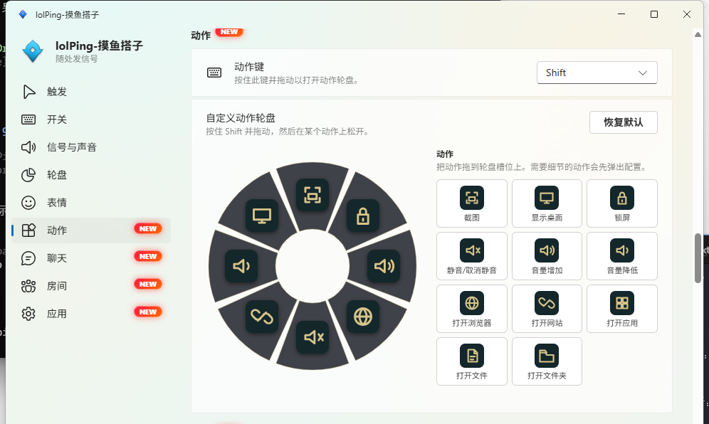
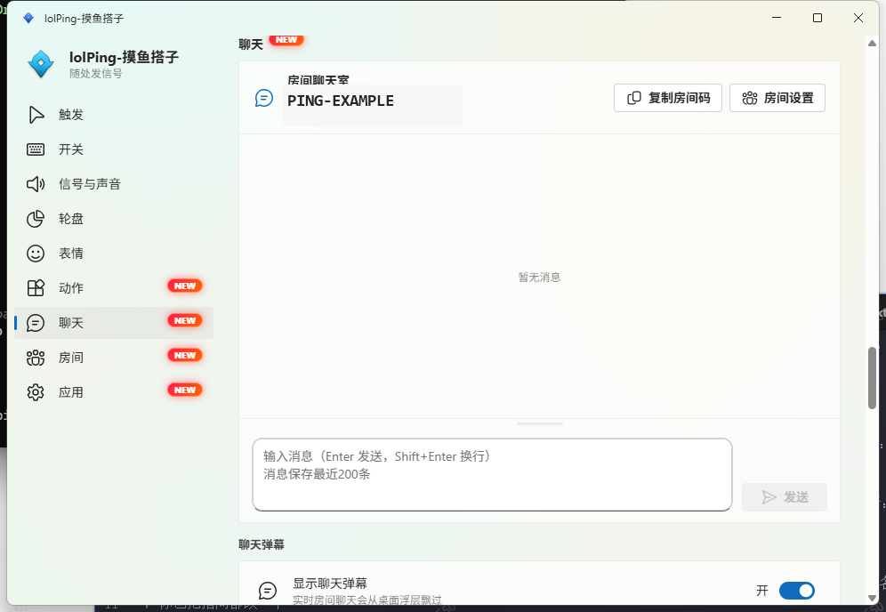
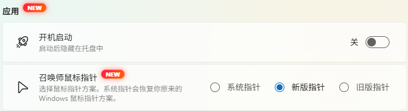
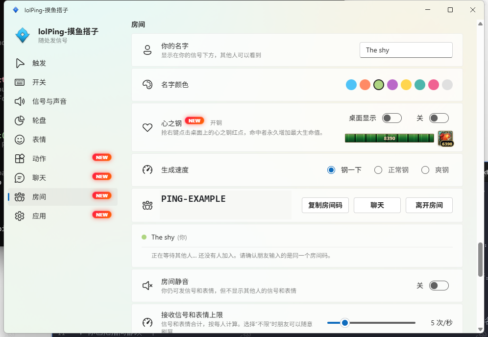

# lolPing-moyudazi

   
  <strong>lolPing-moyudazi</strong>

  Turn a familiar League-style gesture into a Windows desktop command wheel.

  Hold a key, drag to a slice, release, and the action is done. Send a signal, open a tool, chat with friends, or take a short Heartsteel break without leaving the desktop.

  <a href="https://github.com/DreamingBetter/lolPing-moyudazi/releases/latest"><b>Download for Windows</b></a> ·
  <a href="README.zh-CN.md">简体中文</a>

  
  
  

> **Windows only.** lolPing-moyudazi is built and tested for Windows 11 x64. The 0.6.x release line does not support macOS.

## 🎮 Why try lolPing-moyudazi?

lolPing-moyudazi keeps the satisfying hold-and-drag rhythm of an in-game wheel and gives it a place on your whole desktop. It is useful when a normal shortcut feels too hidden, and fun when a routine action deserves a little more personality.

- ⚡ **For work:** take a screenshot, mute a meeting, change volume, show the desktop, or lock Windows with one short gesture.
- **For everyday shortcuts:** keep a favourite website, app, file, or folder one drag away instead of searching through menus.
- 💬 **For friends:** create a room, send pings and emotes, chat in plain text, and let messages float across the desktop as danmaku.
- 🖱️ **For atmosphere:** switch between the modern Summoner cursor, the classic League cursor, and your normal Windows cursor.
- ❤️‍🔥 **For a break:** start Heartsteel alone or invite the room to race for targets and grow your maximum health.

## ✨ What is new in 0.6.0

Version 0.6.0 keeps the original ping and emote wheels and adds a second wheel for desktop actions, plus social, cosmetic, and light entertainment features.

**0.6.1 maintenance update:** Restores the original Windows cursor scheme after switching away from the classic skin and includes the Heartsteel hit sound in the installer.

### ⚡ Action wheel: make desktop work feel like a quick play

Hold **Shift** and drag to open the default action wheel. Release on a slice to open the Windows snipping flow, mute or change volume, show the desktop, lock the screen, open your browser, or launch a configured website. You can replace all eight slots from the built-in library and edit each slot's label, URL, app path, file path, folder path, or volume step.

### 💬 Room chat and danmaku: stay in the same room between matches

Create a room, share its code, and invite friends on the same network or through an internet connection. Room messages are end-to-end encrypted, plain text, and kept in memory while people remain in the room. Turn on danmaku when you want the conversation to appear as a live desktop overlay; choose its display area, speed, font size, and opacity to fit your screen.

### 🖱️ League cursor skins: change the feel of the whole desktop

Choose the system cursor, the modern Summoner cursor, or the classic League cursor pack. Disable the feature at any time and lolPing-moyudazi restores the Windows cursor scheme that was in use before.

### ❤️‍🔥 Heartsteel: open it anytime without launching the game

No game launch is required: start Heartsteel directly from the room settings whenever you want a quick break. Targets appear on the desktop and can be claimed with a right-click before they disappear. A successful hit permanently adds maximum health to the winner. Play solo on your own desktop, or turn it into a room race where everyone sees the same target and the hit result. Pick a relaxed, normal, or fast target pace and keep your health and stacks visible in a draggable desktop widget.

## Get started in 30 seconds

1. Download <code>lolPing-moyudazi-Setup-0.6.1.exe</code> from the <a href="https://github.com/DreamingBetter/lolPing-moyudazi/releases/tag/v0.6.1">0.6.1 release</a> and install it.
2. Find lolPing-moyudazi in the Windows system tray and open <strong>Settings</strong>.
3. Leave the default keys for a first try, or choose your own keys and wheel layout.
4. Hold a trigger key, drag the pointer to a slice, and release. The centre cancels the wheel; right-click and <strong>Esc</strong> also cancel.

The default gestures are:

| Wheel | Gesture | First thing to try |
| --- | --- | --- |
| Ping | Hold **Alt**, drag, release on a slice | Send “On My Way” or “Danger” to the room |
| Emote | Hold **Ctrl**, drag, release on an emote | Drop a reaction without opening a chat window |
| Desktop action | Hold **Shift**, drag, release on an action | Open the snipping flow or mute system audio |

Press **Ctrl + Alt + P** to pause or resume input capture. Click the tray icon whenever you want to change settings.

## 🎯 Try these first

### A three-gesture work flow

1. Hold **Shift** and release on **Screenshot** to open the Windows snipping flow.
2. Hold **Shift** and release on **Mute/unmute** before joining a call.
3. Hold **Shift** and release on **Open browser** when you need a quick search.

Once that feels natural, replace a slot with a website, app, file, or folder you open every day.

### A five-minute room session

1. Open **Settings → Room** and choose **Create room**.
2. Copy the room code and send it to up to seven friends.
3. Use the ping and emote wheels to send quick signals while you work or play.
4. Open **Room chat** for text messages, then enable **Chat danmaku** if you want the conversation on screen.
5. Use the room controls to mute the room, limit incoming pings, or leave when you are done.

### ❤️‍🔥 A Heartsteel break

1. Start Heartsteel from **Settings → Room** without opening the game. It can run solo, or as a shared race while you are in a room.
2. Watch for the desktop target and right-click it before it expires.
3. Check the hit feedback and your growing maximum health.
4. Move the stats widget out of the way, or switch the target pace when you want a calmer or faster round.

## Make it yours

Everything important is available in Settings:

- Change the ping, emote, and action trigger keys. The three keys must be different.
- Drag items from the ping, emote, or action library onto wheel slots and restore the defaults at any time.
- Configure action parameters such as a URL, application path, file path, folder path, or volume change.
- Choose a room name and colour, decide whether internet connections are allowed, and control incoming ping volume.
- Tune danmaku area, speed, font size, and opacity.
- Select a cursor skin and choose the Heartsteel target pace and desktop widget visibility.

## Installation

The Windows installer is available on the <a href="https://github.com/DreamingBetter/lolPing-moyudazi/releases/tag/v0.6.1">0.6.1 release page</a>. The installer is not code-signed, so Windows SmartScreen may require <strong>More info → Run anyway</strong>.

## Build from source

You need Node 22.12 or later, Windows 11 x64, and Visual Studio 2022 or later with the <strong>Desktop development with C++</strong> workload.

~~~powershell
npm ci
npm run build:helper
npm run dev
~~~

Useful checks:

~~~powershell
npm run typecheck
npm run test:helper
npm test
npm run dist
~~~

## Credits and attribution

lolPing-moyudazi is a Windows-focused second development based on <a href="https://github.com/darrenprx/lolPing">darrenprx/lolPing</a>. We are building on the original project's architecture, input model, and wheel renderer while adding the action wheel, room chat, danmaku, cursor skins, and Heartsteel mode described above. Please visit the original project, read its documentation, and consider giving the original author a star:

<strong>Original project:</strong> <a href="https://github.com/darrenprx/lolPing">https://github.com/darrenprx/lolPing</a>

League of Legends assets are property of Riot Games. This project is not endorsed by Riot Games. The source code is available under the <a href="LICENSE">MIT License</a>.
