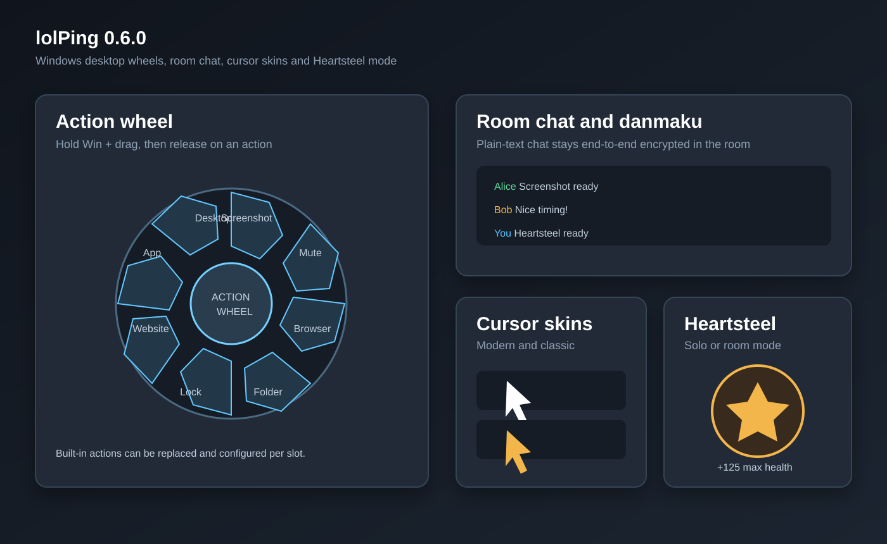

# lolPing

<p align="center">
  <br>
  <strong>lolPing</strong>
</p>

<p align="center">面向 Windows 桌面的英雄联盟信号、表情、快捷动作与房间互动轮盘。</p>

<p align="center">
  <a href="https://github.com/DreamingBetter/lolPing-moyudazi/releases/latest"><b>下载 Windows 版</b></a> ·
  <a href="README.md">English</a>
</p>

<p align="center">
  <a href="https://github.com/DreamingBetter/lolPing-moyudazi/actions/workflows/ci.yml"></a>
  <a href="https://github.com/DreamingBetter/lolPing-moyudazi/releases/latest"></a>
  <a href="LICENSE"></a>
</p>

> **仅支持 Windows。** 本分支面向并测试于 Windows 11 64 位；0.6.x 版本不支持 macOS。

## 0.6.0 更新内容

0.6.0 在保留原有信号轮盘和表情轮盘的基础上，加入可配置的桌面动作轮盘，以及房间、弹幕、指针和心之钢玩法。

- **动作轮盘：** 按住 **Win** 拖动，可执行系统截图、静音和音量调整、显示桌面、锁屏、打开浏览器、网站、应用、文件和文件夹。每个槽位都可以从内置动作库替换，并单独配置参数。
- **房间聊天室：** 房间新增端到端加密的纯文本聊天，并为新加入成员保留最近 200 条内存消息。
- **消息弹幕：** 聊天消息可以显示为轻量桌面弹幕，可调整显示区域、速度、字号和透明度。
- **英雄联盟指针皮肤：** 支持新版 Summoner 指针和经典版指针，关闭后会自动恢复原有 Windows 指针。
- **心之钢娱乐玩法：** 支持单人或房间联机，包含共享目标、命中结果、生命成长和桌面状态小组件。
- **Windows 版本发布：** 安装包、更新源和 Release 流程已切换到本仓库 `DreamingBetter/lolPing-moyudazi`。

<p align="center"></p>

<p align="center"></p>

## 使用方式

| 功能 | 操作 |
| --- | --- |
| 信号 | 按住 **Alt** 拖动，在扇区上松开 |
| 表情 | 按住 **Ctrl** 拖动，在表情上松开 |
| 桌面动作 | 按住 **Win** 拖动，在动作上松开 |
| 取消 | 在中心松开、点击右键或按 **Esc** |
| 暂停 / 恢复 | **Ctrl + Alt + P** |
| 打开设置 | 点击系统托盘图标 |

触发键和轮盘布局都可以在设置中修改。动作轮盘由 Electron 主进程执行，路径、网址和系统操作都在应用边界内处理。

## 房间与聊天

在**设置 → 房间**中创建或加入房间。房间通信使用由房间码派生的密钥进行端到端加密。聊天只支持纯文本，消息保存在内存中，离开房间后清除。聊天页面也可以调整弹幕显示设置。

## 安装

1. 从 [0.6.0 Release](https://github.com/DreamingBetter/lolPing-moyudazi/releases/tag/v0.6.0) 下载 `lolPing-moyudazi-Setup-0.6.0.exe`。
2. 运行安装程序。安装包没有代码签名，Windows SmartScreen 可能需要点击**更多信息 → 仍要运行**。
3. lolPing 启动后驻留系统托盘。打开设置即可修改触发键、动作、房间、指针皮肤和心之钢选项。

## 从源码构建

需要 Node 22.12 或更高版本、Windows 11 64 位，以及安装了“使用 C++ 的桌面开发”工作负载的 Visual Studio 2022 或更高版本。

```powershell
npm ci
npm run build:helper
npm run dev
```

常用检查命令：

```powershell
npm run typecheck
npm run test:helper
npm test
npm run dist
```

## 致谢与二次开发说明

lolPing 0.6.0 是基于 [darrenprx/lolPing](https://github.com/darrenprx/lolPing) 进行的 Windows 方向二次开发。我们沿用了原项目的架构、输入模型和轮盘渲染方案，并在此基础上加入上述功能。感谢原作者的设计与实现，也欢迎大家访问原项目、了解其工作，并为原项目点一个 Star：

**原项目：** <https://github.com/darrenprx/lolPing>

英雄联盟相关素材归 Riot Games 所有。本项目与 Riot Games 没有官方关联。源代码采用 [MIT License](LICENSE)。
